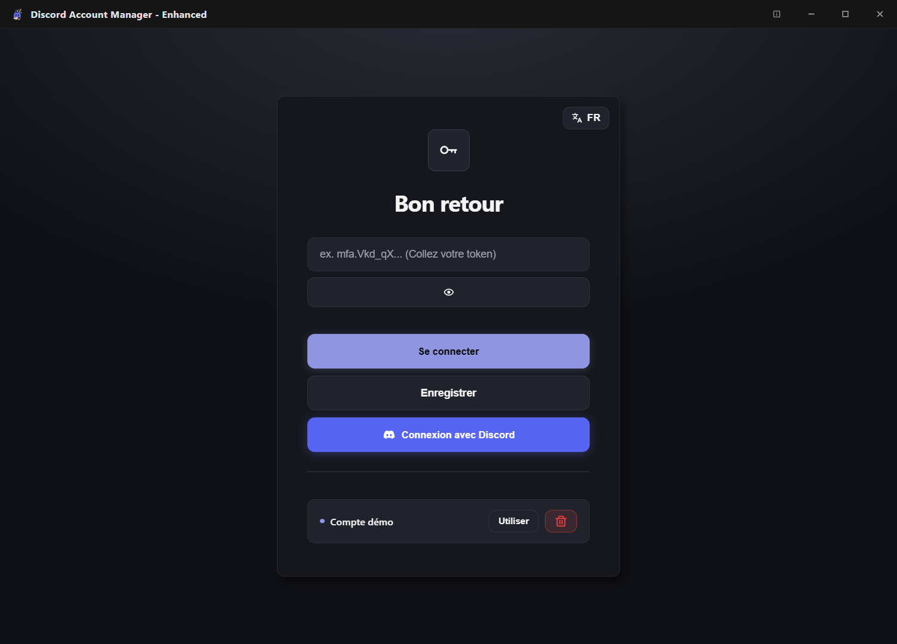
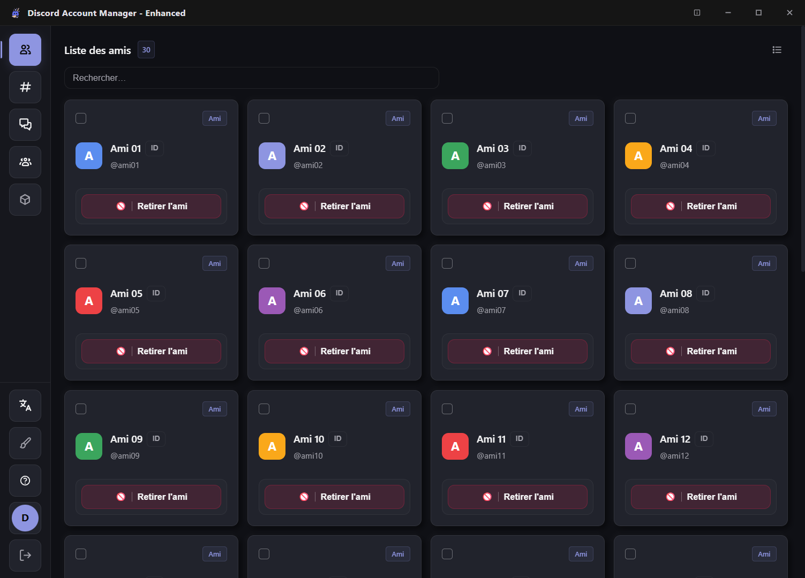
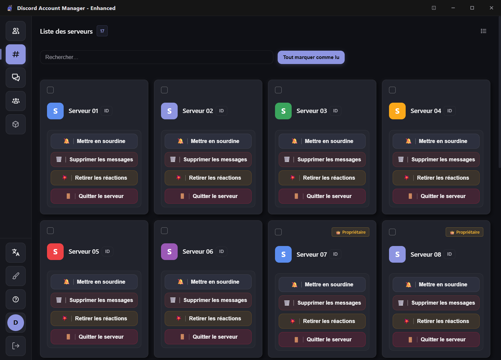
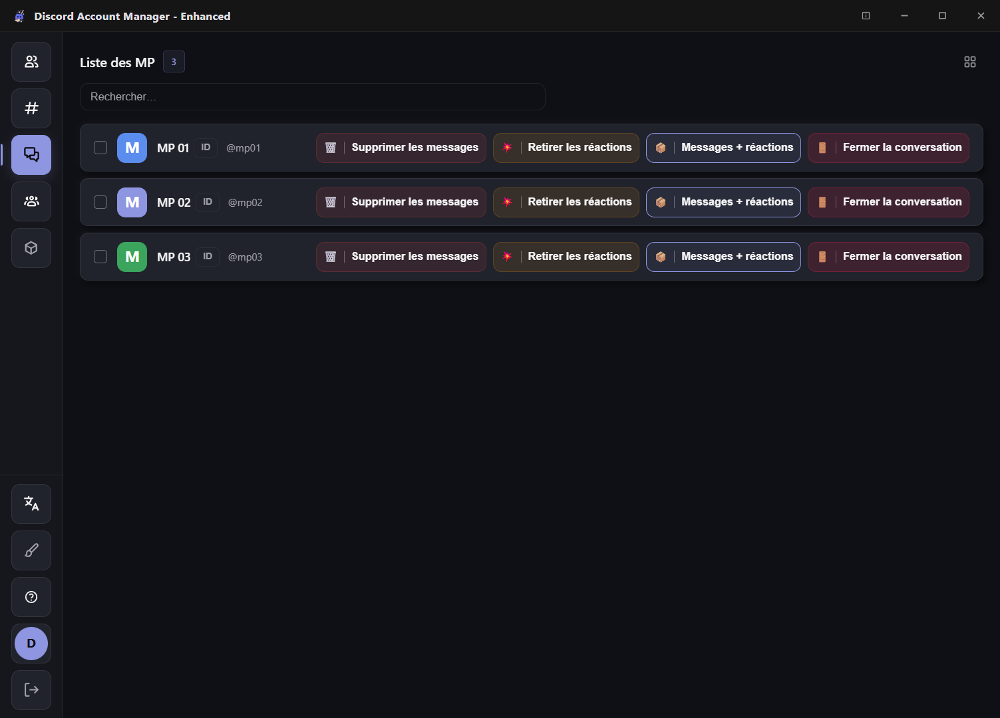
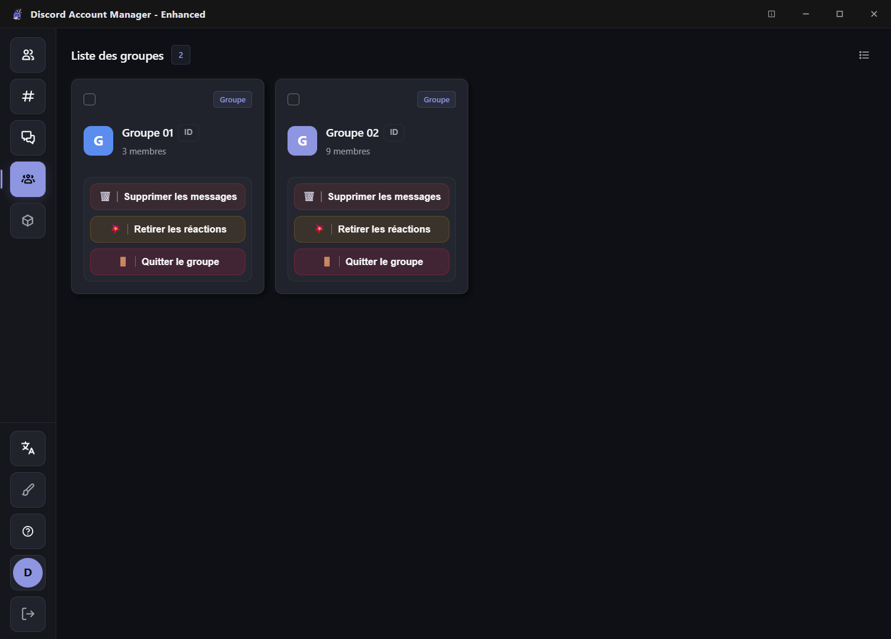
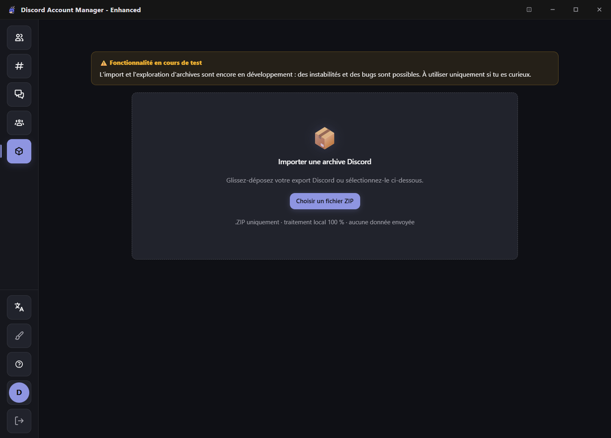
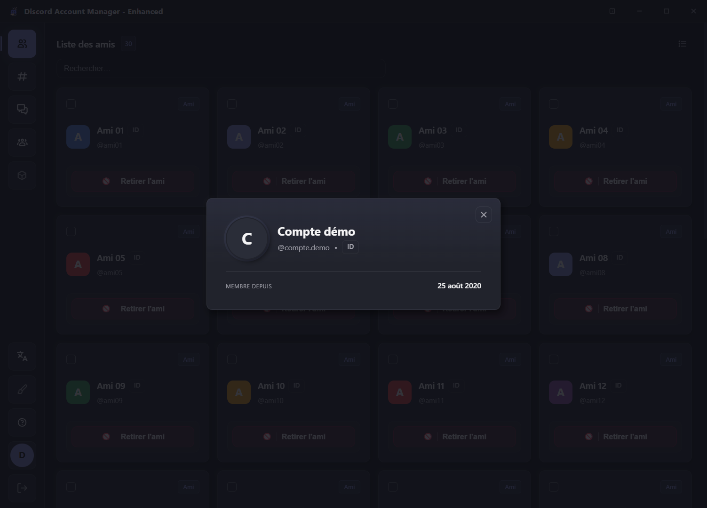
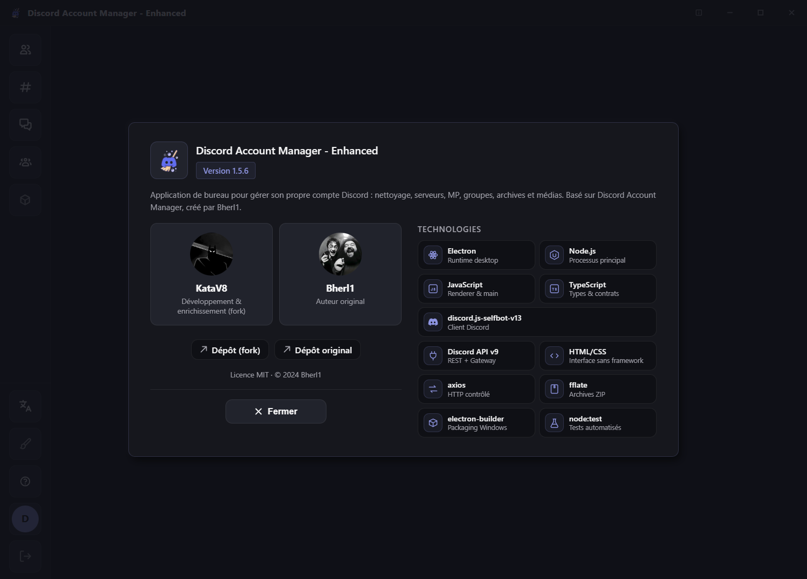
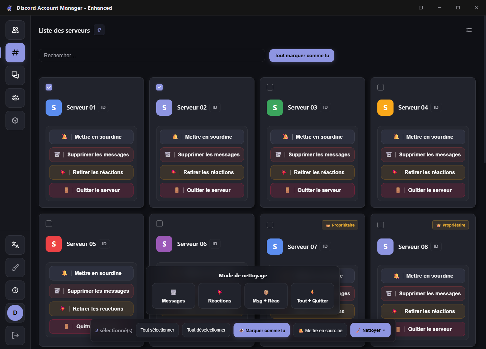
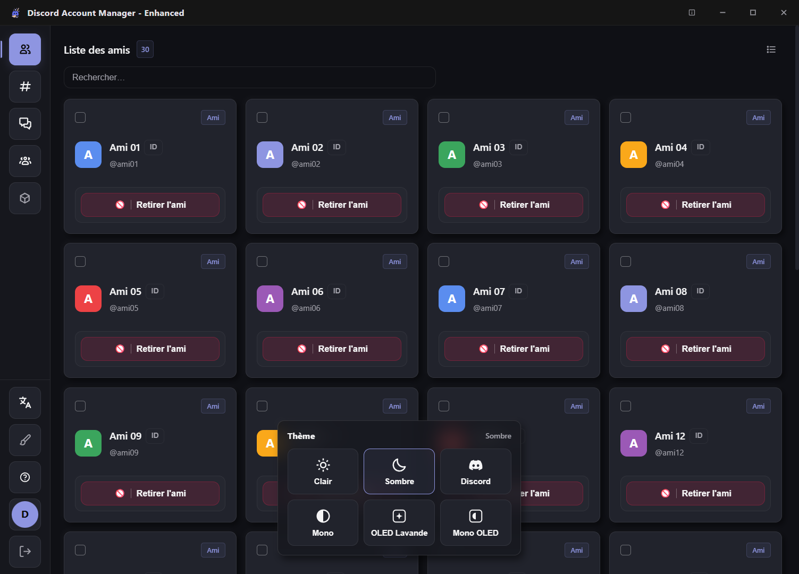

# ` 📘 `︲Discord Account Manager - Enhanced.

<p align="center">
  
</p>

<p align="center">
  <sub>Logo generated by Gemini (Nano-Banana)</sub>
</p>

<p align="center">
  
  
  
  
  
  
  
</p>

---

A desktop Electron application for managing your own Discord account: servers, friends, direct messages, groups, reactions, export archives and media. It centralizes repetitive operations in one interface, with rate control, interruption recovery and local storage.

> **French version:** [README.md](README.md).

> [!NOTE]
> Code, tooling and documentation are mostly generated by AI, under human supervision, testing and review. Based on Discord Account Manager by Bherl1, including KataV8's enhancements. This project can be ignored if AI-assisted development does not meet your trust requirements.

---

> [!CAUTION]
> Using a **user token** with the Discord API (`discord.js-selfbot-v13`, API v9) violates Discord's Terms of Service and may result in account suspension or a ban. The application is intended for managing your own data, without spam or abuse.
>
> **Made with care but with AI.**

---

## ` 📑 `︲Table of contents.

1. [`📘`︲Overview.](#overview)

   * [`✨`︲Features.](#features)
   * [`🧰`︲Tech stack.](#stack)
   * [`📸`︲Gallery.](#gallery)

   ---

2. [`⚡`︲Getting started.](#getting-started)

   * [`📋`︲Prerequisites.](#prerequisites)
   * [`🛠️`︲Installation and launch.](#installation)

   ---

3. [`🧭`︲Usage.](#usage)

   * [`🔌`︲Connection.](#connection)
   * [`🧹`︲Management and cleaning.](#cleaning)
   * [`📦`︲Archives and media.](#archives)

   ---

4. [`⚙️`︲Configuration and data.](#configuration)

   * [`📁`︲Local data.](#data)
   * [`🎨`︲Themes and language.](#themes-language)

   ---

5. [`🔐`︲Security.](#security)

   * [`🔒`︲Privacy and data.](#privacy)

   ---

6. [`🏗️`︲Architecture and structure.](#architecture)

   * [`📁`︲Repository structure.](#structure)

   ---

7. [`🧪`︲Tests and scripts.](#tests)

   * [`📋`︲npm scripts.](#scripts)

   ---

8. [`📦`︲Windows packaging.](#packaging)

   ---

9. [`🩹`︲Troubleshooting.](#troubleshooting)

   ---

10. [`📄`︲License and credits.](#license)

    ---

11. [`🧰`︲Tools and resources.](#tools)

12. [`🗺️`︲Micro Roadmap.](#roadmap)

---

<a id="overview"></a>
# ` 📘 `︲Overview.

---

An Electron-based desktop application designed for efficient management of Discord servers, contacts, and mass message deletion. Based on **DiscordAccMgr** by **Bherl1**.

Discord Account Manager - Enhanced is an Electron application built without a front-end framework or bundler. The renderer uses JavaScript ESM, while the main process and preload use CommonJS. Network operations go through a single entry point in the main process, which applies a scheduler aware of the `X-RateLimit-*` headers.

The interface is available in French and English, with six themes including two OLED variants. Application data stays in a `data/` directory next to the executable.

<a id="features"></a>
### ` ✨ `︲Features.

---

* **Accounts and lists**: native Discord sign-in or manual token, saved accounts, friends, servers, direct messages and groups.
* **Cleaning**: message deletion, reaction removal, combined mode and full mode with server or group exit.
* **Batch processing**: multi-selection, action dock, progress, stop button and checkpoint recovery for servers.
* **Reading and moderation**: mark servers as read, mute servers and copy identifiers.
* **Discord archives**: import a `.zip` export, browse messages by channel, view the photo/video/audio/file gallery and create a local media mirror.
* **Themes and language**: Dark, Light, Discord, Mono, OLED Lavender and Mono OLED themes; French/English interface switchable before or after signing in.

<a id="stack"></a>
### ` 🧰 `︲Tech stack.

---

| Layer | Technology | Version |
|---|---|---|
| Desktop runtime | Electron | 43.8.12 |
| Test runtime | Node.js | 22.18+ |
| Languages | JavaScript ESM/CJS, TypeScript | TypeScript 7.0.2 |
| Interface | HTML, CSS and vanilla JavaScript | not applicable |
| HTTP | axios | 1.21.1 |
| Discord client | discord.js-selfbot-v13 | 3.4.6 |
| ZIP archives | fflate | 0.8.3 |
| Packaging | electron-builder | 26.18.1 |
| Tests | node:test | provided by Node.js |

---

<a id="gallery"></a>
### ` 📸 `︲Gallery.

---

The screenshots below show the main screens with demo data. Names and avatars are anonymized, and the interface is shown in French. Click a screenshot to open it full size.

<table>
  <tr>
    <td width="50%" valign="top">
      <a href="README-SCREENSHOTS/01-connexion.png"></a>
      <br>
      <strong>Sign-in.</strong> Token sign-in or the native Discord window. Saved accounts are encrypted at rest.
    </td>
    <td width="50%" valign="top">
      <a href="README-SCREENSHOTS/02-amis.png"></a>
      <br>
      <strong>Friends.</strong> Friend list with multi-select, ID copy and individual removal.
    </td>
  </tr>
  <tr>
    <td width="50%" valign="top">
      <a href="README-SCREENSHOTS/03-serveurs.png"></a>
      <br>
      <strong>Servers.</strong> Servers with bulk actions: mute, delete messages, remove reactions and leave.
    </td>
    <td width="50%" valign="top">
      <a href="README-SCREENSHOTS/04-messages-prives.png"></a>
      <br>
      <strong>Direct messages.</strong> Private conversations: delete messages, remove reactions and close the conversation.
    </td>
  </tr>
  <tr>
    <td width="50%" valign="top">
      <a href="README-SCREENSHOTS/05-groupes.png"></a>
      <br>
      <strong>Groups.</strong> Groups with the cleaning actions and leaving the group.
    </td>
    <td width="50%" valign="top">
      <a href="README-SCREENSHOTS/06-archives.png"></a>
      <br>
      <strong>Archives.</strong> Local import of a Discord ZIP export, without sending data.
    </td>
  </tr>
  <tr>
    <td width="50%" valign="top">
      <a href="README-SCREENSHOTS/07-profil.png"></a>
      <br>
      <strong>Profile.</strong> Connected account card: name, handle, copyable ID and creation date.
    </td>
    <td width="50%" valign="top">
      <a href="README-SCREENSHOTS/08-informations.png"></a>
      <br>
      <strong>Information.</strong> Version, technologies, fork and original repositories, MIT license.
    </td>
  </tr>
  <tr>
    <td width="50%" valign="top">
      <a href="README-SCREENSHOTS/09-nettoyage.png"></a>
      <br>
      <strong>Cleaning.</strong> Combined cleaning modes and a contextual action bar for selected items.
    </td>
    <td width="50%" valign="top">
      <a href="README-SCREENSHOTS/10-themes.png"></a>
      <br>
      <strong>Themes.</strong> Six themes, including OLED Lavender and Mono OLED variants.
    </td>
  </tr>
</table>

---

<a id="getting-started"></a>
# ` ⚡ `︲Getting started.

---

<a id="prerequisites"></a>
### ` 📋 `︲Prerequisites.

---

| Item | Value | Note |
|---|---|---|
| Node.js | **≥ 22.18** | Required by the tests that import the `.ts` mirrors |
| npm | Bundled with Node.js | Dependency installation |
| System | Windows | Packaging target defined in `package.json` |
| Discord account | Personal account | Native sign-in or user token |

<a id="installation"></a>
### ` 🛠️ `︲Installation and launch.

---

1️⃣︲**Get the repository.**

```bash
git clone https://github.com/K4taV8/DiscordAccMgr-Enhanced.git
cd DiscordAccMgr-Enhanced
```

2️⃣︲**Install dependencies.**

```bash
npm install
```

3️⃣︲**Launch the application.**

```bash
npm start
```

---

<a id="usage"></a>
# ` 🧭 `︲Usage.

---

<a id="connection"></a>
### ` 🔌 `︲Connection.

---

Native sign-in opens a dedicated Discord window: Discord handles the password, 2FA and captcha, then the application captures the session. A user token can also be pasted manually. Saved accounts are encrypted at rest and loaded from the login page.

<a id="cleaning"></a>
### ` 🧹 `︲Management and cleaning.

---

Each card exposes the actions available for its type: message deletion, reaction removal, mute, identifier copy, conversation close or server/group exit. The **Clean** button groups four modes: messages, reactions, messages + reactions, or full cleaning with exit.

A long operation displays progress and can be stopped. Server cleaning uses checkpoints, watermarks and an anti-ghost ledger; direct message and group cleaning restart their scan after an interruption.

> [!WARNING]
> Deletions are **irreversible**. Destructive confirmations are systematic, but no action can undo a deletion already sent to Discord.

<a id="archives"></a>
### ` 📦 `︲Archives and media.

---

Import accepts the official Discord export as a `.zip` file and processes it locally. The Messages view browses conversations by channel; the Gallery view groups photos, videos, audio files and attachments. **Download media** creates a local mirror in `data/media`, served by the internal `media://` protocol.

---

<a id="configuration"></a>
# ` ⚙️ `︲Configuration and data.

---

<a id="data"></a>
### ` 📁 `︲Local data.

---

| Item | Location | Note |
|---|---|---|
| Application data | `data/` next to the executable | Portable mode |
| Tokens | `data/userData/saved_tokens.json` | Encrypted with `safeStorage` |
| Sessions and cache | `data/sessionData/`, `data/cache/` | Local cache |
| Main-process logs | `data/logs/main.log` | 5 MB rotation, 3 archives |
| Media mirror | `data/media/` | Locally downloaded files |

The fallback nominal rates are defined in `electron/rateLimiter.cjs` and applied in `electron/main.cjs`:

| Operation | Nominal rate | Burst | Concurrency |
|---|---|---|---|
| Read | 25 requests/s | 16 | 12 |
| Delete | 4 requests/s | 2 | 4 |

<a id="themes-language"></a>
### ` 🎨 `︲Themes and language.

---

The theme selector in the rail offers Dark, Light, Discord, Mono, OLED Lavender and Mono OLED. The choice is stored in `localStorage`. The language button, available on the login page and in the rail, switches the interface between French and English; the preference is also persisted.

---

<a id="security"></a>
# ` 🔐 `︲Security.

---

* **Tokens**: encryption at rest through `safeStorage`, versioned envelope, serialized and atomic writes (`electron/tokenStore.cjs`, `electron/persist.cjs`).
* **Renderer**: `sandbox`, `contextIsolation`, `nodeIntegration` disabled and a strict CSP (`script-src 'self'`, `connect-src 'self'`) in `index.html`.
* **Network**: a single HTTP path in the main process (`discordFetch`), a global 15 s timeout, rate-header tracking and `maxRedirects: 0` on the Discord API.
* **Media**: `media://` protocol with lexical validation, `realpath` and a check that the target stays inside `data/media`.
* **External links**: URL allowlist for `shell.openExternal` in `electron/main.cjs`.

Sensitive IPC calls (`connectDiscord`, `saveToken`, `getTokens`, `loginNative`) are redacted to `[redacted]` before logging in `electron/preload.cjs`.

<a id="privacy"></a>
### ` 🔒 `︲Privacy and data.

---

> [!IMPORTANT]
> **The application sends your data to no third-party service other than Discord.** It has no backend: apart from the calls required by the Discord API (HTTPS), nothing leaves your PC. The application makes no request to GitHub; an external link opens your browser only if you click it. No telemetry, no analytics, no collection server.

* **Everything stays local**: imported archives, media, caches, preferences and logs are stored in `data/`, next to the executable in portable mode. The token is the only sensitive data encrypted at rest.
* **Token**: encrypted at rest with `safeStorage`, never returned to the renderer or sent to a third party. It only travels over HTTPS to Discord, for the sole calls required by the requested action; sensitive IPC calls are redacted in logs.
* **Media**: downloads go through the main process, with a Discord domain allowlist and local path validation.

---

<a id="architecture"></a>
# ` 🏗️ `︲Architecture and structure.

---

| Subsystem | Files | Role |
|---|---|---|
| Renderer | `src/` | ESM interface, managers, gallery, scan and deletion operations |
| Preload | `electron/preload.cjs` | `contextBridge` bridge, IPC API exposed to the renderer |
| Main | `electron/main.cjs` and `electron/*.cjs` services | Network authority, persistence, tokens, media protocol and login window |

```text
renderer (src/, ESM)
  │  contextBridge / IPC
  ▼
preload.cjs
  │
  ▼
main.cjs (CJS)
  ├─ discordFetch → route scheduler (X-RateLimit-*)
  ├─ persist.cjs → atomic JSON
  ├─ tokenStore.cjs → safeStorage
  └─ media:// → data/media
```

<a id="structure"></a>
### ` 📁 `︲Repository structure.

---

<details>
<summary>📁︲Full tree.</summary>

```text
electron/        main process, preload and services
src/components/  managers, Bento cards, modals and selectors
src/services/    archive import/export, storage, gallery
src/utils/       deletion, reactions, progress, themes, i18n
src/styles/      app.css and themes
src/types/       global TypeScript declarations
shared/          shared types
scripts/         ASAR verification
test/            node:test suite
assets/          logo, avatars and icons
README-SCREENSHOTS/ gallery captures
resources/       packaging resources
index.html       renderer document
```

</details>

---

<a id="tests"></a>
# ` 🧪 `︲Tests and scripts.

---

The suite uses `node:test` and covers the renderer, import/export services, persistence, rate limiting, deletion flows, themes and i18n. `npm test` runs `tsc --noEmit` first, then the tests.

<a id="scripts"></a>
### ` 📋 `︲npm scripts.

---

| Command | Purpose |
|---|---|
| `npm start` | Launch Electron |
| `npm test` | Typecheck, then the `node:test` suite |
| `npm run typecheck` | Check TypeScript types |
| `npm run test:coverage` | Run tests with coverage |
| `npm run audit:sca` | Audit production dependencies |
| `npm run verify:asar` | Verify ESM imports from an ASAR archive |
| `npm run package` | Build the NSIS installer and Windows folder |
| `npm run package:portable` | Build the portable folder |

---

<a id="packaging"></a>
# ` 📦 `︲Windows packaging.

---

The `electron-builder` configuration targets Windows with two outputs: an NSIS installer and an executable folder. The portable folder keeps its data in `data/`, next to the executable, and can be moved without installation.

```bash
npm run package
npm run package:portable
npm run verify:asar
```

Artifacts are written to `dist/`. Windows Defender may warn about the unsigned executable.

---

<a id="troubleshooting"></a>
# ` 🩹 `︲Troubleshooting.

---

**Discord sign-in stays on the login page.**  
The captcha and 2FA are handled inside the Discord window. If the native window does not complete, use manual token sign-in.

**A video does not play.**  
Chromium does not decode `.mov` and `.mkv` files. The player offers to save the file; `.mp4` and `.webm` play directly.

**Where is the data stored?**  
In `data/`, next to the executable in portable mode. Tokens are in `data/userData/saved_tokens.json` and are encrypted.

**A 429 error appears.**  
The scheduler is designed to avoid these responses. Check `data/logs/main.log` and make sure no HTTP call bypasses `discordFetch`.

---

<a id="license"></a>
# ` 📄 `︲License and credits.

---

| Item | Detail |
|---|---|
| ` 🧑‍💻 `︲**Original application** | Created by **Bherl1** ([original repository](https://github.com/Bherl1/DiscordAccMgr)). **(Many thanks for their work!)** |
| ` 🛠️ `︲**Fork and enhancements** | **KataV8** ([fork repository](https://github.com/K4taV8/DiscordAccMgr-Enhanced)): Bento interface, 6 themes, FR/EN, Data Package, gallery and media mirror, native Discord sign-in, full cleanup, rate-limit, hardened security and 602 tests. [Detailed comparison](COMPARISON.en.md). |
| ` 📜 `︲**License** | MIT, see [LICENSE](LICENSE). © 2024 Bherl1. |
| ` 🤝 `︲**Contributions** | The repository has no `CONTRIBUTING` file; changes must keep `npm test`, `npm run typecheck` and `npm run audit:sca` working. |

---

<a id="tools"></a>
# ` 🧰 `︲Tools and resources.

---

The tools, technologies and references used by the project are grouped below. Links are available through the `🌐` icon.

---

* ` 🧩 `︲**Technologies and dependencies:**
  * ` ⚛️ `︲**Electron** ︲[`🌐`](https://www.electronjs.org/)
  * ` 🟢 `︲**Node.js** ︲[`🌐`](https://nodejs.org/)
  * ` 🔷 `︲**TypeScript** ︲[`🌐`](https://www.typescriptlang.org/)
  * ` 🌐 `︲**axios** ︲[`🌐`](https://axios-http.com/)
  * ` 💬 `︲**discord.js-selfbot-v13** ︲[`🌐`](https://www.npmjs.com/package/discord.js-selfbot-v13)
  * ` 🗜️ `︲**fflate** ︲[`🌐`](https://github.com/101arrowz/fflate)
  * ` 📦 `︲**electron-builder** ︲[`🌐`](https://www.electron.build/)

---

* ` 🛠️ `︲**Development and testing tools:**
  * ` 📦 `︲**npm** ︲[`🌐`](https://docs.npmjs.com/)
  * ` 🧪 `︲**node:test** ︲[`🌐`](https://nodejs.org/api/test.html)
  * ` 🗄️ `︲**@electron/asar** ︲[`🌐`](https://github.com/electron/asar)

---

* ` 🖼️ `︲**Assets and media:**
  * ` 🎨 `︲**Boxicons** ︲[`🌐`](https://boxicons.com/)
  * ` 🖼️ `︲**Local logo and avatars**: `assets/logo.png`, `assets/kataV8.jpg`, `assets/bherl1.jpg`

---

* ` 📚 `︲**Documentation and references:**
  * ` 📖 `︲**Electron documentation** ︲[`🌐`](https://www.electronjs.org/docs/latest/)
  * ` 🛰️ `︲**Discord API Reference** ︲[`🌐`](https://discord.com/developers/docs/reference)

---

* ` 🤝 `︲**Credits and external contributions:**
  * ` 👤 `︲**Bherl1, original application** ︲[`🌐`](https://github.com/Bherl1/DiscordAccMgr)
  * ` 👤 `︲**KataV8, fork and enhancements** ︲[`🌐`](https://github.com/K4taV8/DiscordAccMgr-Enhanced)

---

* ` 🤖 `︲**AI assistance:**
  * ` 🧠 `︲**Models used:** Claude Opus 5.5, DeepSeek V4.1, GML 5.3, Gemini (Nano-Banana).
  * ` 💻 `︲**Harness:** OpenCode ︲[`🌐`](https://opencode.ai/)
  * ` 🧩 `︲**Plugin:** Superpowers ︲[`🌐`](https://github.com/obra/superpowers)
  * ` 📚 `︲**Skills:** Matt Pocock ︲[`🌐`](https://github.com/mattpocock/skills)

  > Code, tooling and documentation are mostly generated by AI, under human supervision, testing and review.
  > This project can be ignored if AI-assisted development does not meet your trust requirements.

---

<a id="roadmap"></a>
# ` 🗺️ `︲Micro Roadmap.

---

* ` 📦 `︲**Data Package**: polish the feature, currently unstable.
* ` 🦀 `︲**Tauri**: port the application to Tauri and leave the heavy Electron ecosystem. *(Major undertaking)*

> [!NOTE]
> There is no official roadmap as such. These possible improvements are identified from the current codebase.

---

External links and badge rendering were not verified online.
