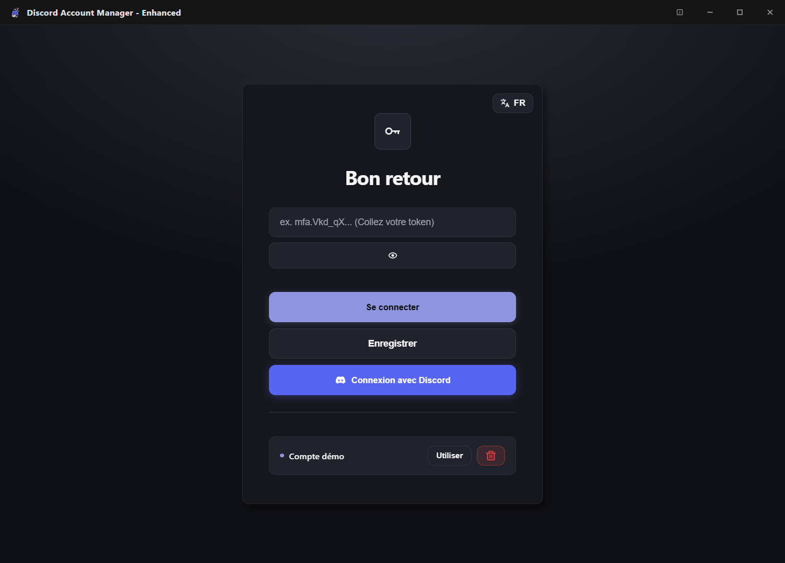
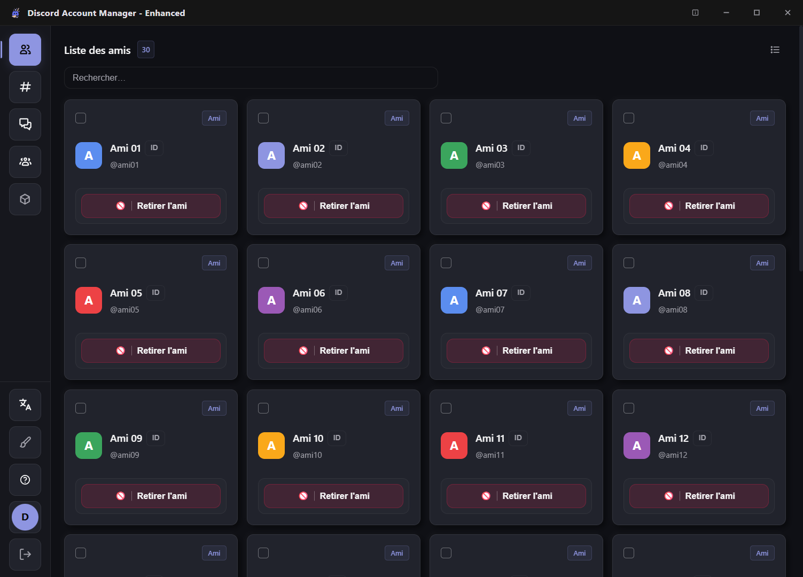
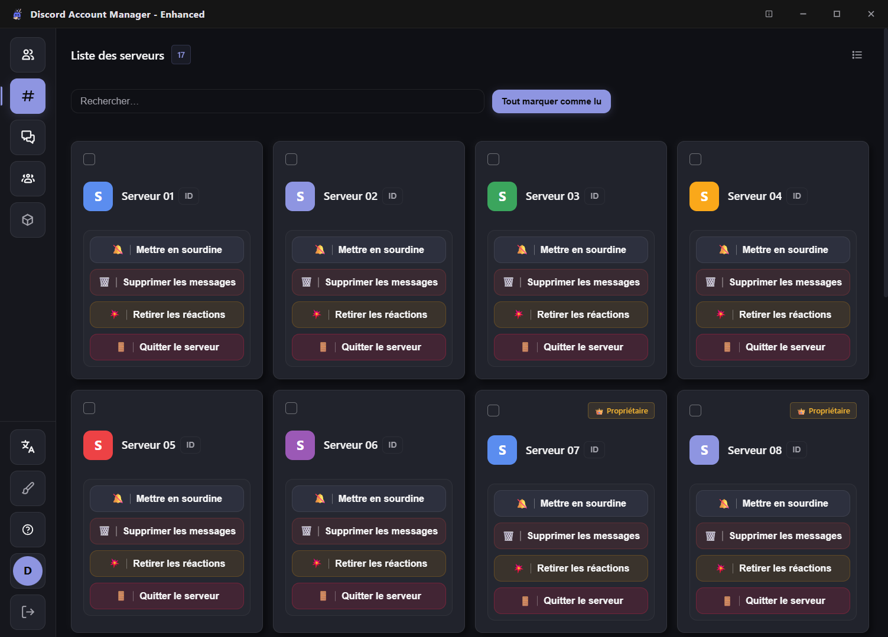
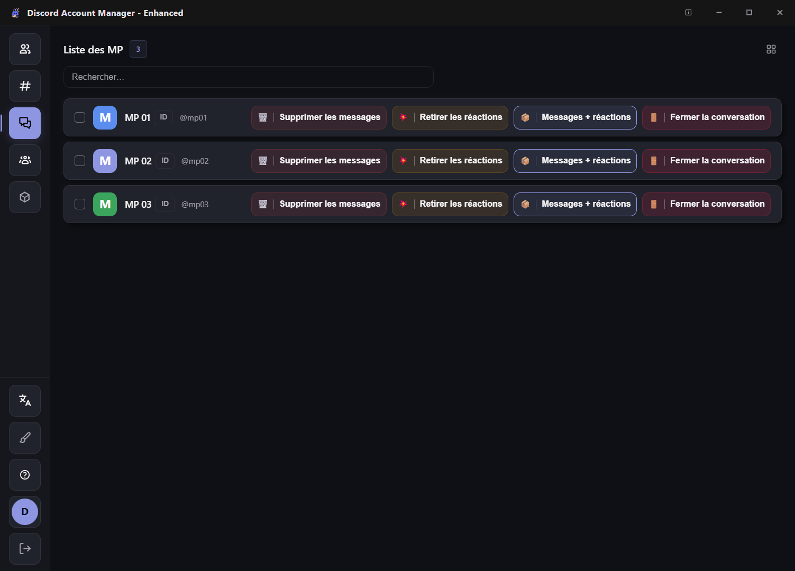
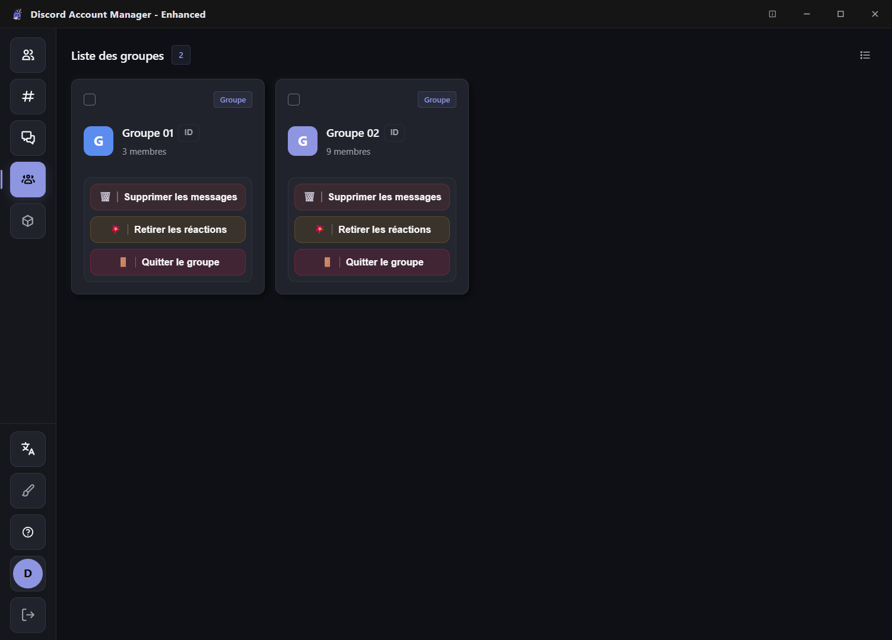
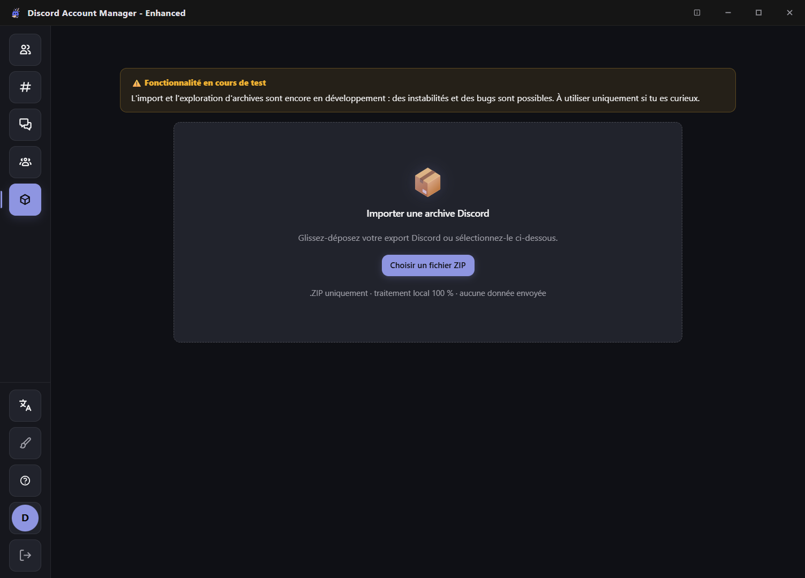
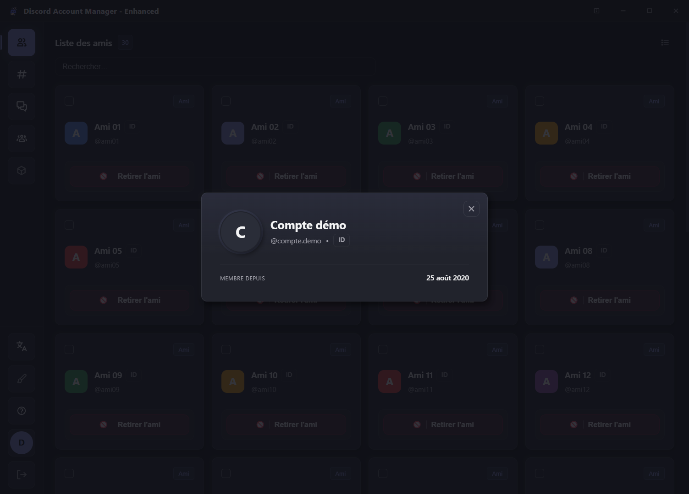
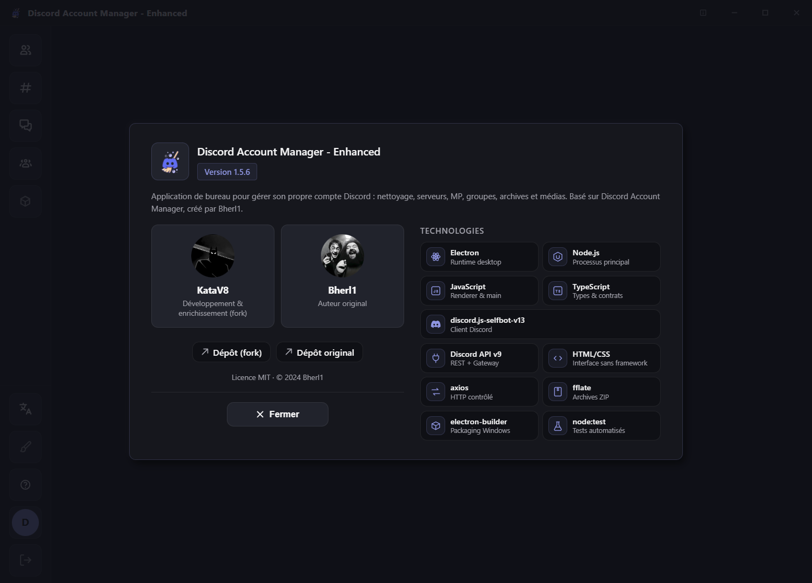
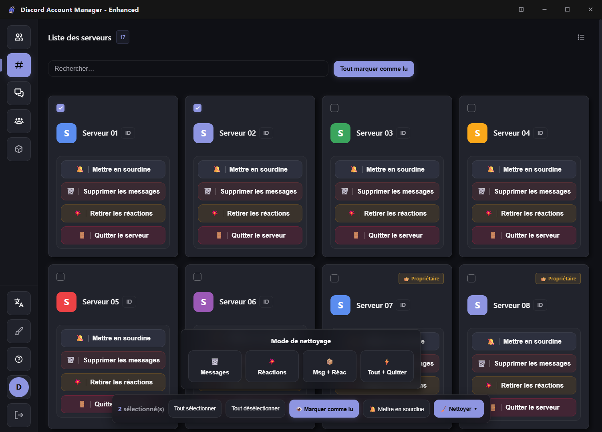
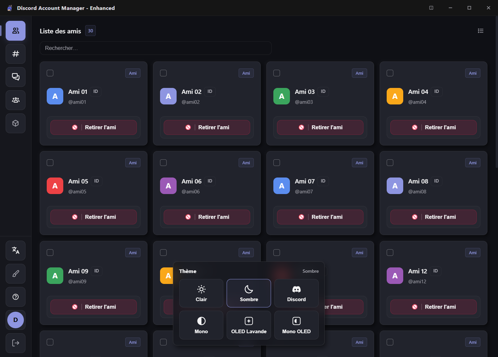

# ` 🫐 `︲Discord Account Manager - Enhanced.

<p align="center">
  
</p>
<p align="center">
  <sub>Logo généré par Gemini (Nano-Banana)</sub>
</p>
<p align="center">
  
  
  
  
  
  
  
</p>

---

Application de bureau Electron pour gérer son propre compte Discord : serveurs, amis, messages privés, groupes, réactions, archives d'export et médias. Elle centralise les opérations répétitives dans une interface unique, avec contrôle du débit, reprise sur interruption et stockage local.

> **English version:** [README.en.md](README.en.md).

> [!NOTE]
> Le code, l'outillage et la documentation sont majoritairement générés par IA, sous supervision, tests et relecture humains. Ce projet est basé sur Discord Account Manager de Bherl1, avec les enrichissements de KataV8. Il peut être ignoré si le développement assisté par IA ne correspond pas à vos exigences de confiance.

---

## ` 📑 `︲Sommaire.

1. [`📘`︲Aperçu.](#apercu)
   * [`✨`︲Fonctionnalités.](#fonctionnalites)
   * [`🧰`︲Stack technique.](#stack)
   * [`📸`︲Galerie.](#galerie)
2. [`⚡`︲Démarrage.](#demarrage)
   * [`📋`︲Prérequis.](#prerequis)
   * [`🛠️`︲Installation et lancement.](#installation)
3. [`🧭`︲Utilisation.](#utilisation)
   * [`🔌`︲Connexion.](#connexion)
   * [`🧹`︲Gestion et nettoyage.](#nettoyage)
   * [`📦`︲Archives et médias.](#archives)

   ---

4. [`⚙️`︲Configuration et données.](#configuration)
   * [`📁`︲Données locales.](#donnees)
   * [`🎨`︲Thèmes et langue.](#themes-langue)
5. [`🔐`︲Sécurité.](#securite)
   * [`🔒`︲Confidentialité et données.](#confidentialite)
6. [`🏗️`︲Architecture et structure.](#architecture)
   * [`📁`︲Structure du dépôt.](#structure)

   ---

7. [`🧪`︲Tests et scripts.](#tests)
   * [`📋`︲Scripts npm.](#scripts)
8. [`📦`︲Packaging Windows.](#packaging)
9. [`🩹`︲Dépannage.](#depannage)

   ---

10. [`🤝`︲Contribution.](#contribution)
11. [`📄`︲Licence et crédits.](#licence)
12. [`🧰`︲Outils et ressources utilisées.](#outils)
13. [`🗺️`︲Micro Roadmap.](#roadmap)

---

> [!CAUTION]
> L'utilisation d'un **jeton utilisateur** avec l'API Discord (`discord.js-selfbot-v13`, API v9) est contraire aux conditions d'utilisation de Discord et peut entraîner une suspension ou un bannissement du compte. L'application est destinée à la gestion de ses propres données, sans spam ni usage abusif.
>
> **Fait avec soin, mais avec l'IA.**

---

<a id="apercu"></a>
# ` 📘 `︲Aperçu.

---

Application de bureau basée sur Electron, conçue pour la gestion efficace des serveurs, des contacts et la suppression massive de messages sur Discord. Basée sur **DiscordAccMgr** par **Bherl1**.

Discord Account Manager - Enhanced est une application Electron sans bundler ni framework front-end. Le renderer est écrit en JavaScript ESM, le processus principal et le preload en CommonJS. Les appels à l'API Discord passent par `discordFetch` dans le processus principal, avec un ordonnanceur qui tient compte des en-têtes `X-RateLimit-*`. Les téléchargements de médias Discord utilisent des transports contrôlés dans le même processus, avec allowlist CDN et limite de taille.

L'application est **100 % portable** : elle se lance depuis son dossier et conserve ses données dans `data/`, sans installation ni passage par `%APPDATA%`.

<a id="fonctionnalites"></a>
### ` ✨ `︲Fonctionnalités.

* **Comptes et listes** : connexion Discord native ou jeton manuel, comptes enregistrés, amis, serveurs, messages privés et groupes.
* **Nettoyage** : suppression des messages, retrait des réactions, mode combiné et mode complet avec sortie du serveur ou du groupe.
* **Traitement par lot** : sélection multiple, dock d'actions, progression, bouton d'arrêt et reprise par checkpoint pour les serveurs.
* **Lecture et modération** : marquage de serveurs comme lus, mise en sourdine et copie d'identifiants.
* **Archives Discord** : import d'un export `.zip`, exploration des messages par salon, galerie photos, vidéos, audio et fichiers, miroir média local.
* **Thèmes et langue** : thèmes Sombre, Clair, Discord, Mono, OLED Lavande et Mono OLED ; interface FR/EN commutable avant ou après connexion.

<a id="stack"></a>
### ` 🧰 `︲Stack technique.

| Couche | Technologie | Version |
|---|---|---|
| Runtime desktop | Electron | 43.8.12 |
| Runtime de test | Node.js | 22.18+ |
| Langages | JavaScript ESM/CJS, TypeScript | TypeScript 7.0.2 |
| Interface | HTML, CSS, JavaScript vanilla | non applicable |
| HTTP | axios | 1.21.1 |
| Client Discord | discord.js-selfbot-v13 | 3.4.6 |
| Archives ZIP | fflate | 0.8.3 |
| Packaging | electron-builder | 26.18.1 |
| Tests | node:test | fourni par Node.js |

---

Les versions sont verrouillées dans `package-lock.json`. Le runtime Node du processus principal est fourni par Electron ; la version `22.18+` concerne les tests qui importent les miroirs `.ts` avec le type stripping de Node.js.

---

<a id="galerie"></a>
### ` 📸 `︲Galerie.

---

Les captures ci-dessous présentent les écrans principaux avec des données de démonstration. Les noms et avatars sont anonymisés, et l'interface est en français. Cliquez sur une capture pour l'ouvrir en taille réelle.

<table>
  <tr>
    <td width="50%" valign="top">
      <a href="README-SCREENSHOTS/01-connexion.png"></a>
      <br>
      <strong>Connexion.</strong> Connexion par jeton utilisateur ou via la fenêtre Discord native. Les comptes enregistrés sont chiffrés au repos.
    </td>
    <td width="50%" valign="top">
      <a href="README-SCREENSHOTS/02-amis.png"></a>
      <br>
      <strong>Amis.</strong> Liste des amis avec sélection multiple, copie d'identifiant et retrait individuel.
    </td>
  </tr>
  <tr>
    <td width="50%" valign="top">
      <a href="README-SCREENSHOTS/03-serveurs.png"></a>
      <br>
      <strong>Serveurs.</strong> Serveurs avec actions groupées : sourdine, suppression des messages, retrait des réactions et sortie.
    </td>
    <td width="50%" valign="top">
      <a href="README-SCREENSHOTS/04-messages-prives.png"></a>
      <br>
      <strong>Messages privés.</strong> Conversations privées : suppression des messages, retrait des réactions et fermeture.
    </td>
  </tr>
  <tr>
    <td width="50%" valign="top">
      <a href="README-SCREENSHOTS/05-groupes.png"></a>
      <br>
      <strong>Groupes.</strong> Groupes avec les actions de nettoyage et la sortie du groupe.
    </td>
    <td width="50%" valign="top">
      <a href="README-SCREENSHOTS/06-archives.png"></a>
      <br>
      <strong>Archives.</strong> Import local d'un export Discord au format ZIP, sans envoi de données.
    </td>
  </tr>
  <tr>
    <td width="50%" valign="top">
      <a href="README-SCREENSHOTS/07-profil.png"></a>
      <br>
      <strong>Profil.</strong> Fiche du compte connecté : nom affiché, nom d'utilisateur, identifiant copiable et date de création.
    </td>
    <td width="50%" valign="top">
      <a href="README-SCREENSHOTS/08-informations.png"></a>
      <br>
      <strong>Informations.</strong> Version, technologies, dépôts du fork et original, licence MIT.
    </td>
  </tr>
  <tr>
    <td width="50%" valign="top">
      <a href="README-SCREENSHOTS/09-nettoyage.png"></a>
      <br>
      <strong>Nettoyage.</strong> Modes de nettoyage combinés et barre d'actions contextuelle pour les éléments sélectionnés.
    </td>
    <td width="50%" valign="top">
      <a href="README-SCREENSHOTS/10-themes.png"></a>
      <br>
      <strong>Thèmes.</strong> Six thèmes, dont les variantes OLED Lavande et Mono OLED.
    </td>
  </tr>
</table>

---

<a id="demarrage"></a>
# ` ⚡ `︲Démarrage.

---

> [!TIP]
> **Pas d'installation requise pour utiliser l'application.** La version portable se lance depuis son dossier et conserve toutes ses données dans `data/`, à côté de l'exécutable. Aucun installateur, aucun passage par `%APPDATA%`.

<a id="prerequis"></a>
### ` 📋 `︲Prérequis.

Ces prérequis concernent la **génération** de `DAM-E-P` et le **développement**. Pour utiliser une version portable déjà générée, aucun prérequis n'est nécessaire : ni Node.js, ni npm, ni Git.

| Élément | Valeur | Remarque |
|---|---|---|
| Node.js | **≥ 22.18** | Nécessaire uniquement pour générer `DAM-E-P` ou lancer les tests ; inutile pour exécuter la version portable. |
| npm | Fourni avec Node.js | Installation des dépendances pour la génération. |
| Git | Optionnel | Le téléchargement du dépôt en ZIP suffit. |
| Système | Windows | Cible de génération et d'exécution de `DAM-E-P`. |
| Compte Discord | Compte personnel | Connexion native ou jeton utilisateur. |

<a id="installation"></a>
### ` 🛠️ `︲Installation et lancement.

---

#### ` 📦 `︲Option A — Générer la version portable `DAM-E-P`.

1️⃣︲**Télécharger le dépôt en ZIP.**
Sur GitHub, cliquer sur **Code** → **Download ZIP**.

2️⃣︲**Extraire le ZIP.**
Décompresser l'archive dans un dossier de travail.

3️⃣︲**Ouvrir un terminal dans le dossier.**
Dans l'Explorateur Windows, ouvrir le dossier extrait, faire un clic droit dans un espace vide → **Ouvrir dans le Terminal** (Windows 11) ou **Ouvrir une fenêtre PowerShell ici** (Windows 10).

4️⃣︲**Installer les dépendances.**
Copier-coller :

```bash
npm install
```

5️⃣︲**Construire la version portable.**
Copier-coller :

```bash
npm run package:portable
```

6️⃣︲**Créer le dossier `DAM-E-P`.**
Ouvrir `dist`, copier le dossier `win-unpacked` à la racine du dépôt, puis le renommer **`DAM-E-P`**.

7️⃣︲**Lancer l'application.**
Ouvrir `DAM-E-P` et double-cliquer sur **`Discord Account Manager.exe`**. Le dossier peut être déplacé, copié sur une clé USB ou supprimé sans installation.

> [!NOTE]
> La génération demande deux commandes à copier-coller ; ensuite, `DAM-E-P` se lance sans commande ni installation. `DAM-E-P\data` contient toutes les données locales : comptes, jetons chiffrés, caches, journaux et médias. Pour sauvegarder ou déplacer l'application, copier le dossier `DAM-E-P` en entier.

<details>
<summary>💻︲Option B — Lancer depuis les sources (développement).</summary>

1️⃣︲**Récupérer le dépôt.**

```bash
git clone https://github.com/K4taV8/DiscordAccMgr-Enhanced.git
cd DiscordAccMgr-Enhanced
```

2️⃣︲**Installer les dépendances.**

```bash
npm install
```

3️⃣︲**Lancer l'application.**

```bash
npm start
```

</details>

---

<a id="utilisation"></a>
# ` 🧭 `︲Utilisation.

---

<a id="connexion"></a>
### ` 🔌 `︲Connexion.

La connexion native ouvre une fenêtre Discord dédiée : Discord gère le mot de passe, la 2FA et le captcha, puis l'application récupère la session. Un jeton utilisateur peut aussi être collé manuellement. Les comptes enregistrés sont chiffrés au repos et rechargés depuis la page de connexion.

<a id="nettoyage"></a>
### ` 🧹 `︲Gestion et nettoyage.

Chaque carte expose les actions disponibles pour son type : suppression des messages, retrait des réactions, mise en sourdine, copie d'identifiant, fermeture d'une conversation ou sortie d'un serveur ou d'un groupe. Le bouton **Nettoyer** regroupe quatre modes : messages, réactions, messages et réactions, ou nettoyage complet avec sortie.

Une opération longue affiche sa progression et peut être arrêtée. Les nettoyages de serveurs utilisent des checkpoints, des watermarks et un ledger anti-fantômes ; les nettoyages de MP et de groupes relancent leur scan après une interruption.

> [!WARNING]
> Les suppressions sont **irréversibles**. Les confirmations destructives sont systématiques, mais aucune action ne peut annuler une suppression déjà envoyée à Discord.

<a id="archives"></a>
### ` 📦 `︲Archives et médias.

L'import accepte l'export Discord officiel au format `.zip` et le traite localement. La vue Messages permet de parcourir les échanges par salon ; la vue Galerie regroupe les photos, vidéos, fichiers audio et pièces jointes. Le bouton **Télécharger les médias** crée un miroir local dans `data/media`, servi par le protocole interne `media://`.

---

<a id="configuration"></a>
# ` ⚙️ `︲Configuration et données.

---

<a id="donnees"></a>
### ` 📁 `︲Données locales.

| Élément | Emplacement | Remarque |
|---|---|---|
| Données applicatives | `data/` à côté de l'exécutable | Mode portable |
| Jetons | `data/userData/saved_tokens.json` | Chiffrés avec `safeStorage` |
| Sessions et cache | `data/sessionData/`, `data/cache/` | Cache local |
| Journaux du main | `data/logs/main.log` | Rotation de 5 Mo, 3 archives |
| Miroir média | `data/media/` | Fichiers téléchargés localement |

Les débits nominaux de secours sont définis dans `electron/rateLimiter.cjs` et appliqués dans `electron/main.cjs` :

| Opération | Débit nominal | Burst | Concurrence |
|---|---|---|---|
| Lecture | 25 requêtes/s | 16 | 12 |
| Suppression | 4 requêtes/s | 2 | 4 |

<a id="themes-langue"></a>
### ` 🎨 `︲Thèmes et langue.

Le sélecteur de thème du rail propose Sombre, Clair, Discord, Mono, OLED Lavande et Mono OLED. Le choix est conservé dans `localStorage`. Le bouton de langue, disponible sur la page de connexion et dans le rail, bascule directement l'interface entre français et anglais, sans menu intermédiaire ; la préférence est également persistée.

---

<a id="securite"></a>
# ` 🔐 `︲Sécurité.

---

* **Jetons** : chiffrement au repos via `safeStorage`, enveloppe versionnée, écritures sérialisées et atomiques (`electron/tokenStore.cjs`, `electron/persist.cjs`).
* **Renderer** : `sandbox`, `contextIsolation`, `nodeIntegration` désactivé et CSP stricte (`script-src 'self'`, `connect-src 'self'`) dans `index.html`.
* **API Discord** : appels centralisés dans `discordFetch` avec timeout global de 15 s, suivi des en-têtes de débit et `maxRedirects: 0`.
* **Médias et CDN** : téléchargements dans le processus principal, allowlist des domaines Discord, limite de 2 GiB, flux et validation du chemin `media://` avec `realpath`.
* **Liens externes** : allowlist d'URL pour `shell.openExternal` dans `electron/main.cjs`.
* **IPC** : les appels sensibles (`connectDiscord`, `saveToken`, `getTokens`, `loginNative`) sont rédigés en `[redacted]` avant journalisation dans `electron/preload.cjs`.

<a id="confidentialite"></a>
### ` 🔒 `︲Confidentialité et données.

---

> [!IMPORTANT]
> **L'application n'envoie vos données à aucun service tiers en dehors de Discord.** Elle n'a aucun backend : en dehors des appels nécessaires à l'API Discord (HTTPS), rien ne quitte votre PC. Aucune requête n'est faite vers GitHub par l'application ; un lien externe ouvre votre navigateur uniquement si vous cliquez dessus. Aucune télémétrie, aucun analytics, aucun serveur de collecte.

* **Tout reste en local** : archives importées, médias, caches, préférences et journaux sont stockés dans `data/`, à côté de l'exécutable en mode portable. Le jeton est la seule donnée sensible chiffrée au repos.
* **Jeton** : chiffré au repos avec `safeStorage`, jamais renvoyé au renderer ni envoyé à un tiers. Il ne circule qu'en HTTPS vers Discord, pour les seuls appels nécessaires à l'action demandée ; les appels IPC sensibles sont masqués dans les journaux.
* **Médias** : les téléchargements passent par le processus principal, avec allowlist des domaines Discord et validation du chemin local.

---

<a id="architecture"></a>
# ` 🏗️ `︲Architecture et structure.

---

| Sous-système | Fichiers | Rôle |
|---|---|---|
| Renderer | `src/` | Interface ESM, managers, galerie, opérations de scan et de suppression |
| Preload | `electron/preload.cjs` | Pont `contextBridge`, API IPC exposée au renderer |
| Main | `electron/main.cjs` et services `electron/*.cjs` | Autorité réseau, persistance, jetons, protocole média et fenêtre de connexion |

```text
renderer (src/, ESM)
  |  contextBridge / IPC
  v
preload.cjs
  |
  v
main.cjs (CJS)
  |-- discordFetch -> route scheduler (X-RateLimit-*)
  |-- persist.cjs -> JSON atomique
  |-- tokenStore.cjs -> safeStorage
  `-- media:// -> data/media
```

<a id="structure"></a>
### ` 📁 `︲Structure du dépôt.

<details>
<summary>📁︲Arborescence complète.</summary>

```text
electron/        processus principal, preload et services
src/components/  managers, cartes Bento, modales et sélecteurs
src/i18n/        dictionnaires et traduction de l'interface
src/services/    import/export d'archives, stockage, galerie
src/utils/       suppression, réactions, progression, thèmes, i18n
src/styles/      app.css et thèmes
src/types/       déclarations TypeScript globales
shared/          types partagés
scripts/         vérification de l'ASAR
test/            suite node:test
assets/          logo, avatars et icônes
README-SCREENSHOTS/ captures de la galerie
resources/       ressources de packaging
docs/            plans et spécifications internes
index.html       document du renderer
```

Les dossiers `data/`, `dist/`, `node_modules/`, `DAME-VERSION-PORTABLE/` et `DAM-E-P/` sont générés localement et ne font pas partie de l'arborescence source.

</details>

---

<a id="tests"></a>
# ` 🧪 `︲Tests et scripts.

---

La suite utilise `node:test` et couvre le renderer, les services d'import et d'export, la persistance, le rate limiting, les suppressions, les thèmes et l'i18n. `npm test` exécute d'abord `tsc --noEmit`, puis les tests.

<a id="scripts"></a>
### ` 📋 `︲Scripts npm.

| Commande | Rôle |
|---|---|
| `npm start` | Lance Electron |
| `npm test` | Typecheck puis suite `node:test` |
| `npm run typecheck` | Vérifie les types TypeScript |
| `npm run test:coverage` | Exécute les tests avec couverture |
| `npm run audit:sca` | Audit des dépendances de production |
| `npm run verify:asar` | Vérifie l'import ESM depuis une archive ASAR |
| `npm run package` | Construit l'installeur NSIS et le dossier Windows |
| `npm run package:portable` | Construit le dossier portable |

---

<a id="packaging"></a>
# ` 📦 `︲Packaging Windows.

---

La configuration `electron-builder` cible Windows avec deux sorties : un installeur NSIS et un dossier exécutable. Le dossier portable conserve ses données dans `data/`, à côté de l'exécutable, et peut être déplacé sans installation.

```bash
npm run package
npm run package:portable
npm run verify:asar
```

Les artefacts sont produits dans `dist/`.

> [!NOTE]
> Aucun certificat de signature de code n'est configuré dans `package.json`. Les exécutables produits ne sont pas signés et Windows peut afficher un avertissement lors de leur lancement.

---

<a id="depannage"></a>
# ` 🩹 `︲Dépannage.

---

**La connexion Discord reste bloquée.**
Le captcha et la 2FA sont gérés dans la fenêtre Discord. Si la fenêtre native ne se termine pas, utiliser la connexion par jeton manuel.

**Une vidéo ne se lit pas.**
Les formats `.mov` et `.mkv` ne sont pas décodés par Chromium. Le lecteur propose l'enregistrement du fichier ; les `.mp4` et `.webm` se lisent directement.

**Où sont stockées les données ?**
Dans `data/`, à côté de l'exécutable en mode portable. Les jetons se trouvent dans `data/userData/saved_tokens.json` et sont chiffrés.

**Un code 429 apparaît ?**
Les 429 sont suivis par l'ordonnanceur. Vérifier `data/logs/main.log` et s'assurer qu'aucun appel à l'API Discord ne contourne `discordFetch`.

---

<a id="contribution"></a>
# ` 🤝 `︲Contribution.

---

Aucun fichier `CONTRIBUTING` n'est fourni dans le dépôt. Les propositions se font via le dépôt du fork : [K4taV8/DiscordAccMgr-Enhanced](https://github.com/K4taV8/DiscordAccMgr-Enhanced).

Les modifications doivent conserver `npm test`, `npm run typecheck`, `npm run audit:sca` et `npm run verify:asar` fonctionnels.

---

<a id="licence"></a>
# ` 📄 `︲Licence et crédits.

---

| Élément | Détail |
|---|---|
| ` 🧑‍💻 `︲**Application originale** | Créée par **Bherl1** ([dépôt original](https://github.com/Bherl1/DiscordAccMgr)). **(Grand merci pour son travail !)** |
| ` 🛠️ `︲**Fork et enrichissements** | **KataV8** ([dépôt du fork](https://github.com/K4taV8/DiscordAccMgr-Enhanced)) : interface Bento, 6 thèmes, FR/EN, Data Package, galerie et miroir média, connexion Discord native, nettoyage complet, rate-limit, sécurité renforcée et 602 tests. [Comparaison détaillée](COMPARISON.md). |
| ` 💡 `︲**Inspiration fonctionnelle** | [Discorch](https://discorch.org/) et [Discrub](https://github.com/pratherbytecraft/discrub) : inspiration pour certaines fonctionnalités. Merci à leurs auteurs. |
| ` 📜 `︲**Licence** | MIT, voir [LICENSE](LICENSE). © 2024 Bherl1. |

---

<a id="outils"></a>
# ` 🧰 `︲Outils et ressources utilisées.

---

Les outils, technologies et références associés au projet sont regroupés ci-dessous. Les liens sont accessibles via l'icône `🌐`.

---

* ` 🧩 `︲**Technologies et dépendances :**
  * ` ⚛️ `︲**Electron** ︲[`🌐`](https://www.electronjs.org/)
  * ` 🟢 `︲**Node.js** ︲[`🌐`](https://nodejs.org/)
  * ` 🔷 `︲**TypeScript** ︲[`🌐`](https://www.typescriptlang.org/)
  * ` 🌐 `︲**axios** ︲[`🌐`](https://axios-http.com/)
  * ` 💬 `︲**discord.js-selfbot-v13** ︲[`🌐`](https://www.npmjs.com/package/discord.js-selfbot-v13)
  * ` 🗜️ `︲**fflate** ︲[`🌐`](https://github.com/101arrowz/fflate)
  * ` 📦 `︲**electron-builder** ︲[`🌐`](https://www.electron.build/)

---

* ` 🛠️ `︲**Outils de développement et tests :**
  * ` 📦 `︲**npm** ︲[`🌐`](https://docs.npmjs.com/)
  * ` 🧪 `︲**node:test** ︲[`🌐`](https://nodejs.org/api/test.html)
  * ` 🗄️ `︲**@electron/asar** ︲[`🌐`](https://github.com/electron/asar)

---

* ` 🖼️ `︲**Assets et médias :**
  * ` 🎨 `︲**Boxicons** ︲[`🌐`](https://boxicons.com/)
  * ` 🖼️ `︲**Logo et avatars locaux** : `assets/logo.png`, `assets/kataV8.jpg`, `assets/bherl1.jpg`

---

* ` 📚 `︲**Documentation et références :**
  * ` 📖 `︲**Documentation Electron** ︲[`🌐`](https://www.electronjs.org/docs/latest/)
  * ` 🛰️ `︲**Discord API Reference** ︲[`🌐`](https://discord.com/developers/docs/reference)

---

* ` 🤝 `︲**Crédits et contributions externes :**
  * ` 👤 `︲**Bherl1, application originale** ︲[`🌐`](https://github.com/Bherl1/DiscordAccMgr)
  * ` 👤 `︲**KataV8, fork et enrichissements** ︲[`🌐`](https://github.com/K4taV8/DiscordAccMgr-Enhanced)

---

* ` 🤖 `︲**Assistance par IA :**
  * ` 🧠 `︲**Modèles utilisés :** Claude Opus 5.5, DeepSeek V4.1, GML 5.3, Gemini (Nano-Banana).
  * ` 💻 `︲**Harness :** OpenCode ︲[`🌐`](https://opencode.ai/)
  * ` 🧩 `︲**Plugin :** Superpowers ︲[`🌐`](https://github.com/obra/superpowers)
  * ` 📚 `︲**Skills :** Matt Pocock ︲[`🌐`](https://github.com/mattpocock/skills)

  > Code, outillage et documentation générés majoritairement par IA, sous supervision, tests et relecture humains.
  > Ce projet peut être ignoré si le développement assisté par IA ne correspond pas à vos exigences de confiance.

---

<a id="roadmap"></a>
# ` 🗺️ `︲Micro Roadmap.

---

* ` 📦 `︲**Data Package** : peaufiner la fonction, actuellement instable.
* ` 🦀 `︲**Tauri** : porter l'application vers Tauri et quitter l'écosystème Electron lourd. *(Gros chantier)*

> [!NOTE]
> Il n'existe pas à proprement parler de feuille de route officielle. Ces pistes d'évolution sont identifiées à partir du code actuel.

---

Les liens externes et le rendu des badges n'ont pas été vérifiés en ligne.
